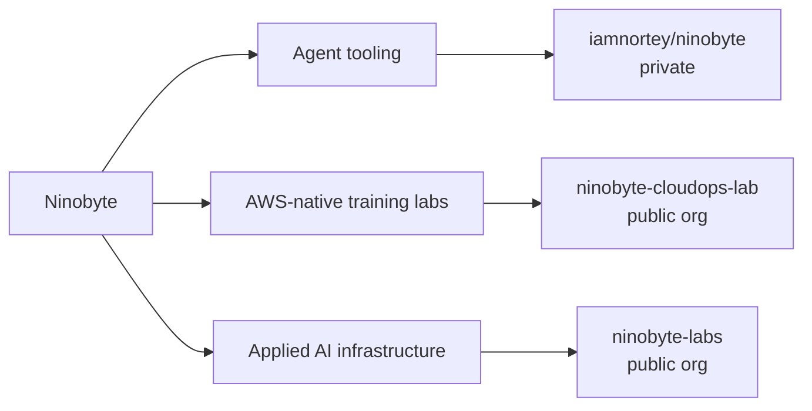

# Ninobyte

> Governance-first agent tooling, AWS-native training labs, and applied AI infrastructure.

---

## What it is

Ninobyte is a multi-product effort to bring engineering rigor to applied AI work. It spans three connected product lines:

1. **Agent tooling** — Claude Skills, MCP servers, and Claude Code plugins with full validation trails against official Anthropic documentation.
2. **AWS-native training labs** — governed, evidence-based AI CloudOps and security training, delivered through ticket-driven job simulation and proof-pack-style portfolio artifacts.
3. **Applied AI infrastructure** — schemas, governance, and product systems for AI-native applications in education and regulated contexts.

The throughline across all three is the same: evidence-based engineering, governance before deployment, and proof of work over passive certificates.

---

## The problem

- "Applied AI" content is largely unverified — skills, MCP servers, and tutorials drift from official documentation
- Cloud AI courses teach vocabulary without giving learners a safe place to operate workloads
- Education data work in emerging markets often skips rights, schema, and governance discipline
- Practitioners and reviewers need auditable evidence, not asserted expertise

Ninobyte addresses these by treating governance, validation, and evidence as first-class deliverables across every product line.

---

## Product lines

### Agent tooling

Lives in the private parent repository [`iamnortey/ninobyte`](https://github.com/iamnortey/ninobyte) (private).

| Component | Purpose |
|---|---|
| **Senior Developer's Brain** | Job system for enterprise engineering workflows — also available as a Claude Code plugin |
| **MCP Server Templates** | Boilerplate and patterns for MCP server development |
| **Claude Code Plugins** | Extensions packaged for Claude Code |
| **Skill packs** | Validated against official Anthropic documentation before release |

### AWS-native training labs

Lives in the public organization [`ninobyte-cloudops-lab`](https://github.com/ninobyte-cloudops-lab).

| Lab | Audience | Status |
|---|---|---|
| [**AI-Native CloudOps Lab**](https://github.com/ninobyte-cloudops-lab/cloudops-lab-overview) | Cloud builders, operators, emerging AWS/AI engineers, defensive security learners | Platform foundation; live AWS cohort readiness gated |
| [**AI Security & Governance Lab — AWS Edition**](https://github.com/ninobyte-cloudops-lab/ai-security-governance-lab-overview) | Cloud security engineers, GRC analysts, IT auditors, security managers, AI governance pros | Docs-first foundation complete; AWS execution gated |
| [**Student workspace model**](https://github.com/ninobyte-cloudops-lab/student-workspace-preview) | Enrolled learners and cohort participants | Private template beta-ready; delivery workflow pending |

### Applied AI infrastructure

Lives in the public-profile organization [`ninobyte-labs`](https://github.com/ninobyte-labs) (org profile public; product repos private).

| Project | Purpose |
|---|---|
| **Ghana Education Data OS (GEDOS)** | Governed control plane for Ghana curriculum and exam intelligence — JSON Schemas, governance and rights policy, review/promotion lifecycle |
| **GEDOS Teacher Portal** | Fumadocs + Payload teacher resource portal |
| **Teacher-to-Author Lab** *(concept stage)* | Training to help Ghanaian teachers turn governed exam intelligence into original lesson notes |
| **Applied AI product engineering** | Schemas and product systems for AI-native applications in regulated contexts (e.g., the metabolic-platform mobile guidance project) |

---

## Key patterns

| Pattern | What it means in practice |
|---|---|
| **Validation-first** | Every skill is validated against official Anthropic sources before release. Every claim links back to documentation. |
| **Governance versioning** | Governance documents get semantic versioning, not just code. Policies are auditable changes, not unwritten norms. |
| **Evidence trails** | Decisions are recorded in ADRs and validation logs. Lab work produces sanitized proof packs. |
| **Phase-gated development** | No Phase 2 until Phase 1 passes all quality gates. Applies to product, labs, and data work alike. |
| **Public/private boundary discipline** | Public-track repos hold schemas, documentation, diagrams, and safe samples. Implementation details, learner materials, instructor keys, and rights-sensitive data stay private. |

---

## Ecosystem at a glance

---

## What's public vs private

This repository contains architecture documentation, governance patterns, ADR examples, and validation methodology at a strategic level. Implementation details are split across three repositories:

- [`iamnortey/ninobyte`](https://github.com/iamnortey/ninobyte) — private parent for agent tooling (Senior Developer's Brain, MCP servers, Claude Code plugins)
- [`ninobyte-cloudops-lab`](https://github.com/ninobyte-cloudops-lab) — public org with three public overview repositories; product repos remain private
- [`ninobyte-labs`](https://github.com/ninobyte-labs) — public org profile; product repos (GEDOS, teacher portal, metabolic-platform) remain private

For partnership, cohort, or technical discussions, reach Ninobyte through its official channels.

---

## Related

- [Portfolio](https://github.com/iamnortey/portfolio) — case studies, architecture, ADRs, runbooks
- [Case Study](https://github.com/iamnortey/portfolio/blob/main/case-studies/ninobyte.md) — full project deep-dive
- [`ninobyte-cloudops-lab`](https://github.com/ninobyte-cloudops-lab) — AWS training labs org
- [`ninobyte-labs`](https://github.com/ninobyte-labs) — applied AI and education data org
